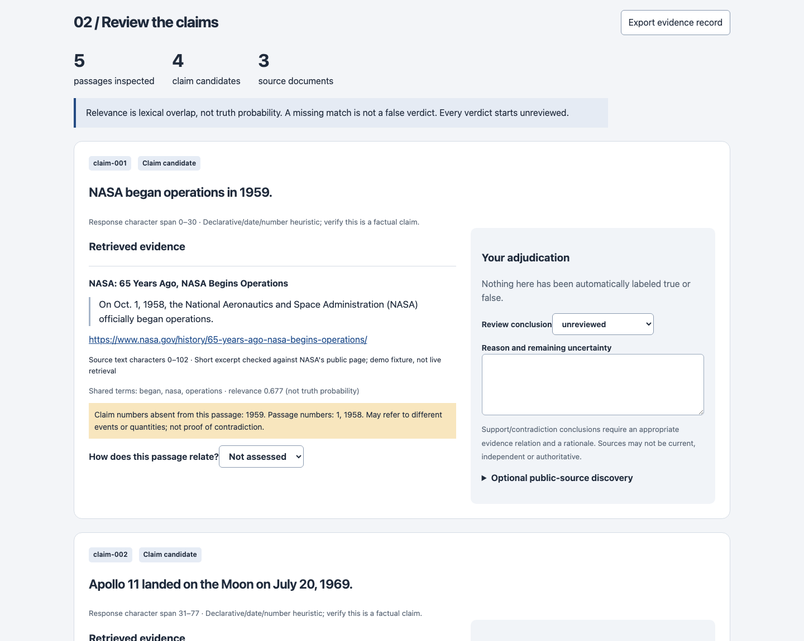

# Ledger — AI-response claim & evidence workbench

**Paste a response → extract factual-claim candidates → retrieve source passages → inspect discrepancies → adjudicate and export.**

Ledger makes the evidence trail inspectable. It automatically splits English passages, identifies likely factual statements, ranks relevant excerpts, and surfaces numeric/negation differences. It deliberately **does not equate lexical overlap with truth** or assign an automatic true/false label.

This is an AI-assisted engineering prototype developed for editorial evaluation. No employment, independent coding proficiency, measured accuracy or private platform experience is claimed.



## Run locally

```sh
cd tools/claim-evidence
python3 -m claimcheck.server
```

Open **http://127.0.0.1:8770**. Local analysis uses only the Python standard library (Python 3.9/3.12 CI). Paste your response and one or more source excerpts with public HTTPS attribution links. Click **Extract claims & retrieve evidence**. Alternatively, load the clearly labeled public-source demo.

The browser communicates only with this loopback server. No response or source text is transmitted externally during local analysis. Nothing is persisted automatically; stop the server with Ctrl+C. Do not expose this development server to a network or use it as a multi-user service.

## Optional real source discovery

```sh
python3 -m venv .venv
source .venv/bin/activate
pip install -r requirements.txt
python -m claimcheck.server
```

Each claim has **Optional public-source discovery**. Review/edit the proposed keyword query and check the approval box before searching. The backend sends **that query only** to English Wikipedia/Wikimedia, searches up to three pages, and fetches their summaries. It does not send the full response or private source corpus. Editing the query clears approval.

Results are **secondary-source leads**, not primary-source verification. Add a useful summary to the corpus, then rerun local analysis. Source URL, retrieval timestamp, source revision timestamp and license attribution are preserved. A revision timestamp is not treated as an original publication date. Editing a retrieved source marks the current text user-edited and clears its current retrieval dates. Immutable original-source attribution, license and dates are retained separately, rather than pretending the new text was fetched unchanged or erasing the original license.

No arbitrary URL-fetch endpoint exists. Discovery uses a fixed HTTPS host and fixed API paths; titles are URL-encoded; redirects and non-200 responses are rejected; downloaded JSON is bounded. Supplied source URLs are metadata, not fetch instructions. Errors stay errors: no substitute evidence or fake citation is generated.

## What the automation actually does

1. **Exact candidate spans.** Sentence and semicolon boundaries preserve character offsets into the original text. A transparent English predicate/date/number heuristic identifies likely claims. Questions, opinions and unrecognized forms remain visible for scope review; they are not silently declared nonfactual. Compound statements are flagged because one sentence may contain several assertions.
2. **Source retrieval.** Local passages are ranked by IDF-weighted term overlap. The interface shows exact quotes, source-text spans, shared terms and the relevance score. This score is **not a calibrated confidence or truth probability**.
3. **Discrepancy cues.** Number and negation differences create review hints. They can concern different events, quantities, entities or grammatical scopes. For example, a mission identifier such as “11” can be detected as a number; the tool does not pretend to know its semantic role.
4. **Coverage disclosure.** No match means only that this corpus/retrieval method did not find a match. Overlong passages (>2,000 characters) are counted as skipped. Identical source text is grouped while preserving alternate source links; copied text does not become independent corroboration.
5. **Human adjudication.** Evidence starts unassessed and conclusions start unreviewed. Supporting/contradicting conclusions require an appropriately marked passage and a rationale; mixed requires both. These are workflow checks, not a guarantee that the user's conclusion is correct.
6. **Traceable export.** Download JSON with original response/hash, source text/hash/provenance, claim and evidence offsets, automation cues and separate human-entered review. Inputs changed during an analysis invalidate that pending result. Later edits disable export until rerun.

## Demonstration, not a benchmark

The public demo response is deliberately authored with a wrong NASA operations year, a correct Moon-landing date, an incorrect launch date, an unsupported universal safety claim and an opinion. It is **not an actual AI-model output or an accuracy experiment**.

Short source excerpts were checked against:
- https://www.nasa.gov/history/65-years-ago-nasa-begins-operations/
- https://science.nasa.gov/resource/saturn-apollo-program-2/
- https://www.archives.gov/historical-docs/apollo-11-flight-plan

The interface can retrieve relevant passages and highlight the year discrepancy, but it cannot independently certify source authority, causal meaning or whether a statement is universally true. In particular, launch and landing dates can share most words while referring to different events. The human must read the cited material.

## Practical boundaries

- English-focused deterministic heuristics, **not an LLM-based atomic-claim extractor**. Implicit facts, complex grammar, coreference, sarcasm and paraphrases can be missed.
- No semantic entailment engine, autonomous broad-web investigation, automatic primary-source discovery, WER-like benchmark, model ranking or truth score.
- Optional discovery is limited to Wikipedia summaries. It is useful for leads but insufficient alone for high-stakes or current claims. No claim that multiple Wikipedia pages are independent sources.
- Up to 20,000 response characters, 80 response passages, 12 sources, 50,000 characters per source, 4,000 indexed passages. One local request at a time. No cancellation UI, login, persistent database or production hardening.
- Source origin and dates supplied manually are not authenticated. Export contains source text and attribution URLs: review it before sharing. No external posting, submitting or publishing occurs automatically.
- Reviewer drafts are in memory until export. No draft-import feature yet; refreshing loses unsaved changes. A requested download is not proof that the file was saved.

## Tests and reproducibility

```sh
python3 -m unittest discover -s tests -v
```

Fast tests require only the standard library. Optional browser integration:

```sh
pip install playwright
python -m playwright install chromium
# Start the server separately, then:
CLAIMCHECK_URL=http://127.0.0.1:8770 python tests/browser_smoke.py
```

The optional browser test deliberately approves a public NASA query to exercise live Wikimedia discovery. It also tests review gates, export, stale-input races and provenance reset. It uses an isolated test browser, not a personal Chrome profile. See `VERIFICATION.md` for actual results and remaining gaps.

## Research references

- https://github.com/petar-nauka/article-fact-check — evidence provenance and exact claim/source location as a workflow reference; no code copied.
- https://www.mediawiki.org/wiki/API:REST_API/Reference — search endpoint documentation.
- https://www.mediawiki.org/wiki/Wikimedia_REST_API — summary service documentation.

UI, retrieval rules and tests were developed with AI assistance. Wikimedia content remains subject to its source-page licenses and attribution requirements; the original public article links remain visible. The tool's safeguards reduce mistakes but do not replace source evaluation or professional judgment.
