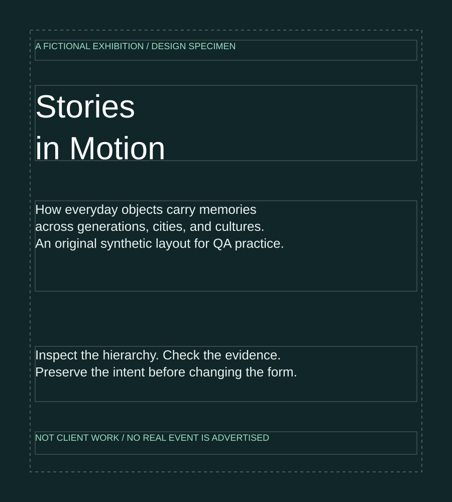
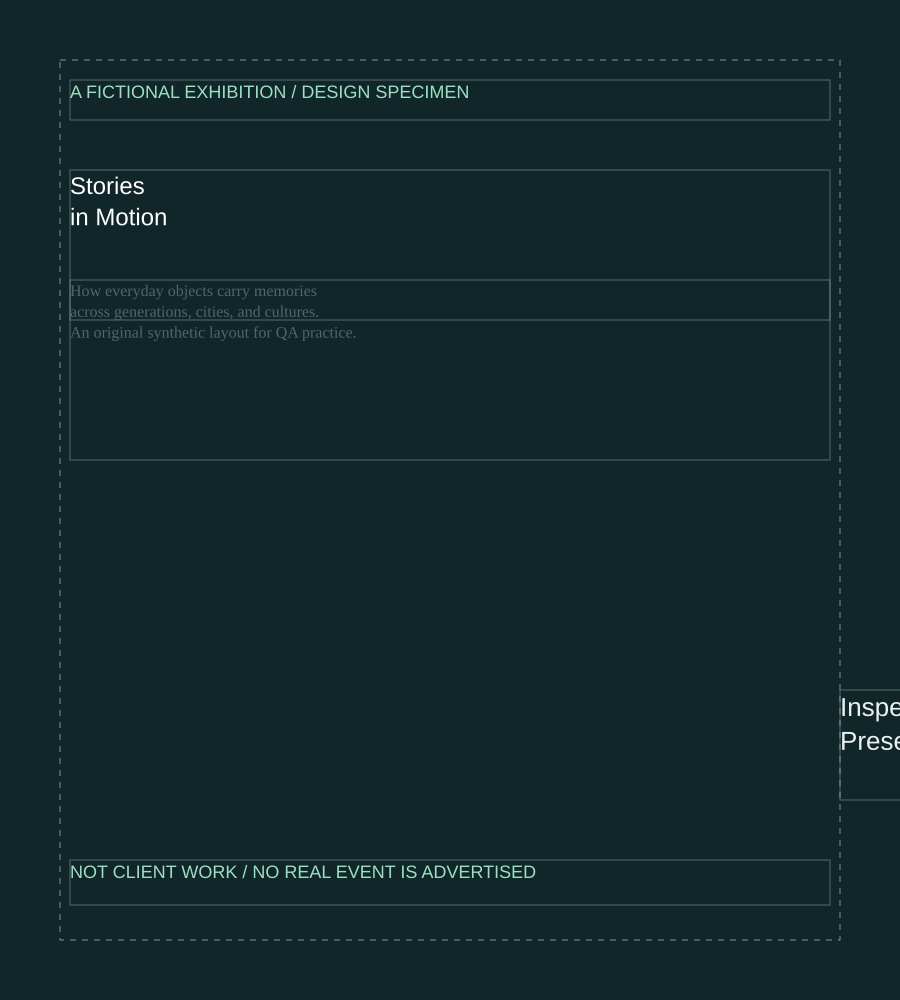

# Layout Preflight

**Check the specification. Preserve the designer's intent. Review the actual artwork.**

A small Python tool that turns a declared layout specification into an original SVG specimen and an evidence-based review queue. It connects editorial/design practice with reproducible quality checks rather than claiming that an algorithm can decide whether a design is beautiful.

Created with AI assistance for an editorial and design QA portfolio. All examples are original synthetic exercises, not client work, museum photographs, real event advertisements, proprietary platform tasks, or evidence of independently authored programming experience.

## Compare the examples

### Consistent specification



### Deliberately defective specification



The bad example produces seven specific findings: insufficient contrast, an unapproved font family, undersized body text, a rectangle beyond the canvas, weak configured size hierarchy, overlapping declared rectangles, and inconsistent body font families. The consistent example produces no configured-rule violations; that does **not** certify it is publication-ready.

## Run

Python 3.9 or newer. Standard library only. No account, model, API key, or network requests.

```bash
python3 -m unittest discover -s tests -v
python3 -m preflight examples/good.json --output reports/good
python3 -m preflight examples/bad.json --output reports/bad
```

Open `reports/good/report.html` or `reports/bad/report.html` locally. On GitHub, download the HTML file first; source view does not execute HTML. SVG images display directly in this README.

Exit codes: **0** means no error-level findings (warnings may remain); **1** means one or more error-level findings; **2** means invalid input or an execution failure. A nonzero exit for the deliberately bad sample is expected.

## What it checks

- Strict JSON shape, finite numbers, unique box IDs, and explicit design rules.
- Declared rectangles inside canvas and safe margins.
- Opaque foreground text against one solid canvas background.
- Body minimum size and headline/body size ratio from the project's own brief.
- Font families outside the declared system, and variation within one role.
- Geometric overlap of declared rectangles, flagged for human interpretation.

The color calculation uses sRGB relative luminance and `(lighter + 0.05) / (darker + 0.05)`. This project conservatively requires **4.5:1 for all text roles**, without large-text or logo exemptions. It compares the unrounded ratio to the threshold. This is not a full WCAG audit. See [W3C's contrast guidance](https://www.w3.org/WAI/WCAG22/Understanding/contrast-minimum.html).

Margins, minimum type size, and hierarchy ratio are **project settings**, not universal accessibility or museum design standards. All coordinates and type sizes here are CSS-style pixels, not print dimensions. Every numeric input is bounded to an absolute maximum of 100,000 (the canvas remains capped at 10,000 px per side). This deliberate prototype limit prevents extreme integer conversion and non-finite derived geometry; values outside it are rejected rather than rendered.

## Remediation map

| Finding in the bad specimen | Targeted repair in the consistent specimen |
| --- | --- |
| Body contrast 2.544:1 | Use the light foreground defined in the design system |
| Body set to 16 px | Restore 26 px, exceeding the 24 px project minimum |
| Unexpected body typeface | Restore Arial without changing unrelated elements |
| Detail box beyond the right edge | Return it to x=70 within the safe area |
| Headline too close to body size | Restore 64 px heading versus 26 px body |
| Declared heading/body collision | Move body below heading, leaving deliberate spacing |
| Mixed body families | Keep one body family across both blocks |

These repairs operate on the declared brief. The next step is visual review, not blindly accepting every machine warning.

## What still needs judgment

The tool cannot measure actual glyph bounds, line wrapping, font substitution, visual balance, factual accuracy, spelling, image resolution, print color, reading order, or how a physical exhibit works at viewing distance. Solid outlines are declared boxes, not measured text boundaries. Lines in the SVG are manually authored in the JSON rather than automatically wrapped.

Overlap can be intentional. A font variation can be justified. A clean report is a starting point for reviewing the rendered artifact, not permission to publish. Transparent colors, gradients, background images, overlapping backgrounds, and complex script/font behavior are outside this version's model.

## A useful reviewer response

Weak: "This layout is bad."

Specific: "The body is specified at 16 px against a 24 px project minimum, uses a different family, and has 2.544:1 contrast against the declared background. Restore the agreed family and size, choose a higher-contrast foreground, then inspect the exported artifact for fit. Do not shrink every page merely to eliminate one collision."

## Verification

29 tests pass locally on Python 3.9.6. Tests cover known contrast endpoints, symmetry, exact margin boundaries, touching versus overlapping rectangles, booleans/non-finite numbers, duplicate keys/IDs, injection escaping, malformed input, nonmutation, and CLI exit codes. The SVG and HTML are generated successfully. Browser-based visual verification has not been performed in this isolated build; review the specimens before treating them as finished presentation assets.

Output files are preflighted and staged before individual replacement. Multiple replacements are not one atomic transaction; rerun after an interrupted process. This is a local prototype, not a production design-ingestion service.

## Files

- `preflight/core.py`: schema and deterministic checks
- `preflight/render.py`: escaped SVG and offline HTML
- `preflight/__main__.py`: command-line workflow
- `examples/`: original synthetic specifications
- `reports/`: reproducible artifacts
- `tests/`: unit and integration checks
