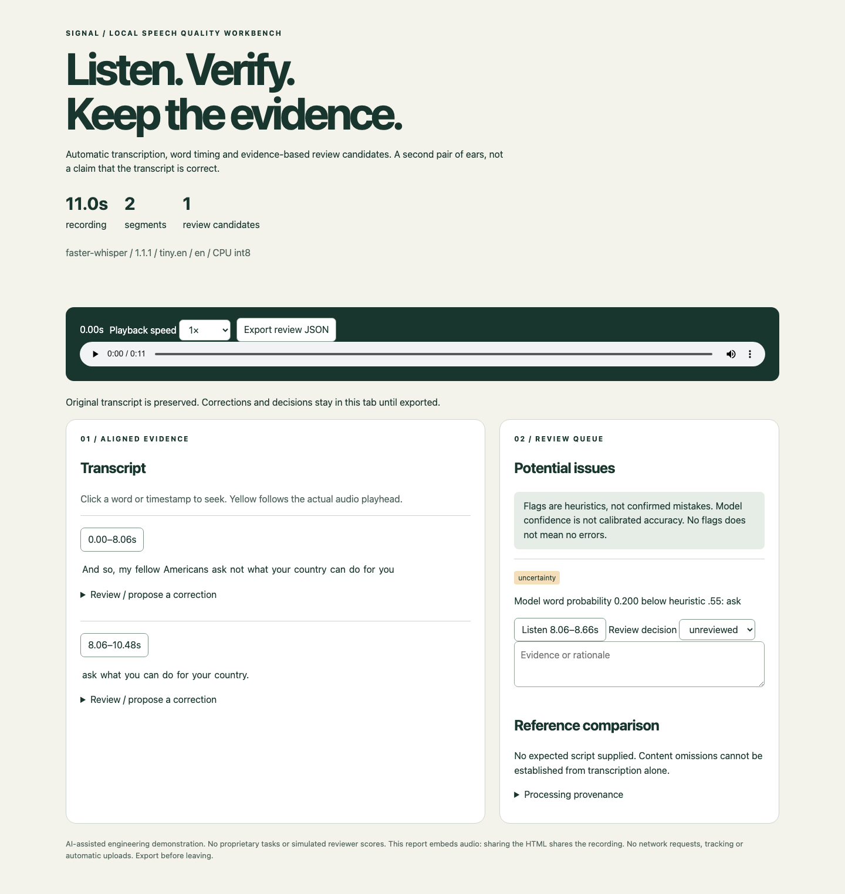

# Signal — automatic speech QA

**Import a recording → real local ASR → word timestamps → automatic review candidates → listen, correct and export.**

This is a working AI-assisted engineering prototype, not a certification of transcript accuracy or a claim of professional ASR research. It complements the repository's text-only ReviewBench with actual audio evidence. It does not fabricate reviewer scores or expose proprietary platform tasks.



## Start the local app

Use Python 3.10–3.12 in a virtual environment (Python 3.9 also tested on this Mac).

```sh
cd tools/speech-qa
python3 -m venv .venv
source .venv/bin/activate
pip install -r requirements.txt
python -m speechqa.server
```

Open **http://127.0.0.1:8765**. Select an audio file and optionally paste an expected script. Click **Transcribe & analyze locally**. First use downloads the selected model from Hugging Face; CPU processing can take minutes. The upload UI is English-only; CLI supports a Whisper language code and multilingual model. Smaller models are quicker but can miss more speech.

The app binds loopback only. Keep it private; do not expose the port to the Internet. It supports one job at a time, up to 100 MB and 30 minutes; no queue, cancellation or background service. Temporary input/output files are removed after the response or failure. Stop with Ctrl+C. Audio is sent from your browser to your own computer, not a third-party transcription API. Model download does use the Internet. Proxy users may need `pip install 'httpx[socks]'`.

## Command-line workflow

```sh
python -m speechqa recording.wav --model base.en --out /tmp/my-speech-review
# Optional supplied reference:
python -m speechqa recording.wav --reference expected.txt --out /tmp/my-speech-reference
```

An existing output directory is never overwritten. Open `index.html` for playback and `analysis.json` for machine-readable evidence. Browser output uses 16 kHz mono PCM for compatibility, without trimming source time. The original recording remains untouched. Reports embed the audio; **sharing HTML shares the recording**. This is not a public upload service.

## What is automatic

- faster-whisper CPU/int8 transcription, segment and word timestamps, actual model signals.
- Independent Silero voice-activity detection on the untrimmed recording. No VAD filtering before ASR, so timing stays on the source timeline.
- Gaps of at least 0.75 seconds between detected speech and the union of word intervals become **uncovered-speech candidates**.
- Low model word probability (<0.55), low segment average log probability (<−0.8), compression ratio (>2.4), invalid/overlapping timestamps, and text in regions with little VAD support (<10%) become review candidates.
- Optional normalized script comparison highlights deletions, insertions and substitutions via sequence matching. This is **not WER**, a forced aligner, or a ground-truth oracle. A source script can differ from what was actually spoken.

## What still requires judgment

Speech detection can mistake music or noise for speech and miss quiet/accented speech. An uncovered interval is not proof of omission. Model probabilities are not calibrated correctness scores. Incorrect transcription can be confidently wrong. Word timestamps are ASR estimates, not manually verified boundaries. No flags does not imply no errors. The tool does not invent missing words or silently replace the transcript.

Click word/timestamp buttons to seek the real audio player. The highlighted word follows `currentTime`, including seeking and speed changes. Propose corrections separately from the immutable original; confirm/dismiss flags with a rationale; export a versioned JSON containing provenance, originals, flags and your review. Drafts stay in memory, not browser storage. Export before refreshing. The browser cannot verify whether you saved a requested download. There is no draft import yet.

See [the observed silence failure](examples/README.md) for a concrete, reproducible example of why human review remains necessary.

## Architecture and evidence

`__main__.py` decodes/inferences; `core.py` contains deterministic rules; `server.py` provides a loopback upload form; `report.py/html/js` builds the offline report. Private audio never belongs in this public repository. Use only recordings you are authorized to process and share.

References informing the implementation:
- https://github.com/SYSTRAN/faster-whisper — inference, word timestamps, CPU int8, VAD integration.
- https://github.com/snakers4/silero-vad — independent speech activity detection.
- https://github.com/m-bain/whisperX — distinction between ASR timestamps and separate alignment; not bundled.
- https://github.com/jianfch/stable-ts — timestamp refinement reference; not bundled.

All UI and checking code here was developed with AI assistance. No external UI/code was copied from portfolio owners. Model and dependency licenses remain their authors'. This is a focused single-user prototype, not a hosted production service.

## Tests

```sh
python -m unittest discover -s tests -v
```

Deterministic tests need only Python's standard library. Actual model downloads and inference are intentionally separate from fast CI. See `VERIFICATION.md` for what was actually exercised, rather than assuming that passing unit tests verifies speech accuracy or browser playback.

### Reproduce the optional browser smoke test

After starting the server above, in another terminal:

```sh
pip install playwright
python -m playwright install chromium
mkdir -p tests/fixtures
curl -L --fail https://raw.githubusercontent.com/openai/whisper/main/tests/jfk.flac -o tests/fixtures/jfk.flac
python tests/browser_smoke.py
```

The fixture folder is ignored by Git. Only use this public upstream test fixture here; do not place confidential audio into tracked files. Playwright uses its own isolated test browser. The local server must remain running for the test.
